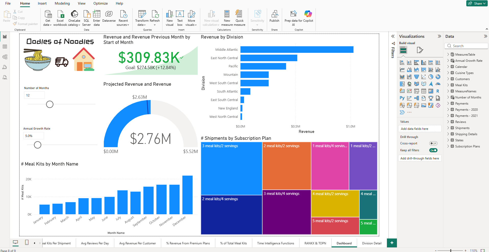

# 📊 Power BI – Operational Performance & Logistics KPI Case Study

## *(Business Intelligence Dashboard | Oodles of Noodles)*

*Animated portfolio visualization highlighting revenue performance, regional operations, shipment trends, and subscription analytics.*

## 🌎 Overview

This project develops an end-to-end business intelligence solution for **Oodles of Noodles**, a multi-regional meal-kit subscription and delivery business. The dashboard consolidates revenue, shipment, subscription, and regional performance data into a centralized analytics platform to support operational monitoring and strategic decision-making.

Through interactive Power BI reporting, the solution enables users to evaluate revenue against targets, compare regional performance, analyze monthly shipment volumes, and model projected revenue using dynamic What-If parameters.

## 🎯 Objective

Develop a centralized business intelligence reporting solution that transforms operational and financial datasets into actionable performance indicators, enabling stakeholders to monitor revenue growth, evaluate regional performance, analyze shipment demand, and forecast business outcomes.

## ❓ Business Challenge

Operational sales, shipment, customer, and subscription data were distributed across multiple datasets, making it difficult to evaluate overall business performance through a unified reporting framework.

Without centralized analytics, identifying revenue trends, comparing geographic divisions, understanding subscription demand, and evaluating potential growth scenarios required additional manual analysis.

## 💡 Solution

Built an interactive Power BI dashboard that integrates operational and financial data into a centralized executive reporting platform.

The dashboard enables users to:

- 💰 Monitor revenue performance against established financial targets
- 🌎 Compare revenue contributions across geographic divisions
- 📦 Analyze monthly meal-kit shipment volumes and demand patterns
- 🍜 Evaluate subscription plan distributions and product configurations
- 📈 Model projected revenue through adjustable What-If parameters
- 🎛️ Explore performance metrics through interactive reporting and filtering

## 📊 Dashboard Performance Highlights

| KPI | Dashboard Result |
|---|---|
| Revenue | **$309.83K** |
| Revenue Target | $274.58K |
| Performance vs. Target | **+12.84%** |
| Projected Revenue | **$2.76M** |
| Forecast Scale | $0–$5.52M |
| Leading Revenue Division | Middle Atlantic |
| Highest Shipment Month | December |
| Forecast Parameters | Number of Months & Annual Growth Rate |

*Figures reflect the dashboard scenario displayed in the Power BI report and are not presented as live business results.*

## 🛠️ Key Skills Demonstrated

- 🗄️ Relational data modeling and schema configuration
- 🔄 Data ingestion, transformation, and preparation using Power Query
- 🧠 DAX measures and calculated columns for business performance analysis
- 📊 KPI development, revenue tracking, and variance analysis
- 📈 Revenue forecasting and What-If scenario modeling
- 🌎 Geographic division and operational performance analysis
- 📦 Shipment volume and subscription demand analytics
- 🎨 Interactive dashboard design and executive reporting

## ⚙️ Analytics Process

### 📥 Step 1: Ingest Sales and Logistics Data

Imported operational datasets containing transactional records, customer information, shipment activity, and regional business data into Power BI Desktop.

### 🗂️ Step 2: Structure Relational Data Models

Developed a relational reporting model to connect transactional, customer, and regional datasets, supporting consistent relationships between operational measures and reporting dimensions.

### 🧹 Step 3: Clean and Transform Operational Data

Used Power Query to prepare datasets for analysis by addressing missing values, standardizing fields, adjusting data types, and structuring records for reliable reporting.

### 📊 Step 4: Develop Revenue and Operational KPIs

Created DAX measures and calculated fields to evaluate revenue performance, compare actual results against financial targets, and monitor operational metrics.

The dashboard includes revenue tracking, goal comparisons, geographic revenue contributions, and monthly shipment analysis.

### 🎛️ Step 5: Engineer Interactive Executive Dashboards

Designed interactive visualizations to consolidate key business metrics into a single reporting interface.

Dashboard components include:

- Revenue KPI cards and target comparisons
- Regional revenue ranking charts
- Monthly meal-kit shipment trends
- Subscription plan distribution treemaps
- Projected revenue gauge visualizations
- Adjustable forecasting parameters

### 📈 Step 6: Implement What-If Revenue Forecasting

Configured dynamic What-If parameters for the number of months and annual growth rate, allowing users to evaluate how different assumptions influence projected revenue.

The displayed scenario uses a 12-month period and a 5.0% annual growth-rate parameter, producing a projected revenue value of $2.76M.

### 🚚 Step 7: Analyze Shipment and Subscription Performance

Developed visualizations to evaluate monthly meal-kit shipment patterns and compare subscription configurations by meal-kit quantity and serving size.

These analyses support a clearer understanding of demand distribution, seasonal volume changes, and regional business performance.

## 🔎 Business Insights

### 💰 Revenue Performance

The displayed revenue of **$309.83K** exceeds the established $274.58K target by approximately $35.25K, representing a 12.84% positive variance.

### 🌎 Regional Revenue Concentration

The Middle Atlantic division represents the largest revenue contributor in the displayed regional comparison, followed by East North Central and Pacific.

This highlights the importance of understanding geographic revenue concentration when evaluating business performance.

### 📦 Shipment Demand Trends

Monthly meal-kit shipment volumes generally increase throughout the displayed year, with December representing the highest-volume month.

This provides a foundation for analyzing demand patterns, operational capacity, and shipment planning.

### 🍜 Subscription Plan Distribution

The subscription treemap compares different meal-kit and serving configurations, allowing users to examine how shipment activity is distributed across subscription offerings.

### 📈 Revenue Scenario Modeling

What-If parameters enable users to adjust forecasting assumptions and observe corresponding changes in projected revenue, supporting scenario evaluation rather than relying on a single static projection.

## ✅ Outcome

Developed a centralized business intelligence dashboard that transforms disconnected operational datasets into an interactive reporting environment for revenue analysis, regional performance monitoring, shipment tracking, subscription evaluation, and financial scenario modeling.

The project demonstrates how Power BI can support business decision-making by combining data transformation, relational modeling, DAX calculations, and executive-level visual reporting into a unified analytics solution.

## 💻 Tools Used

- ⚡ **Power BI Desktop** – Interactive dashboards and business intelligence reporting
- 🔄 **Power Query** – Data ingestion, cleaning, and transformation
- 🧠 **DAX (Data Analysis Expressions)** – Calculated measures, KPIs, and forecasting logic
- 🗄️ **Power BI Data Modeling** – Relational tables and reporting relationships
- 📊 **What-If Parameters** – Dynamic revenue scenario analysis

## 📂 Project Files

- [📊 Power BI Dashboard (.pbix)](Oodles%20of%20Noodles%20-%20Final.pbix)
- [🖼️ Original Dashboard Screenshot](dashboard-Screenshot_.png)
- [🎬 Animated Dashboard Preview](oodles-operations-dashboard.svg)

## 🖥️ Original Power BI Dashboard

*Original Power BI dashboard showing revenue KPIs, projected revenue, regional comparisons, monthly shipment volumes, and subscription distributions.*

---

**Project Focus:** Business Intelligence | Operational Analytics | Revenue Forecasting | Power BI | DAX | Power Query
